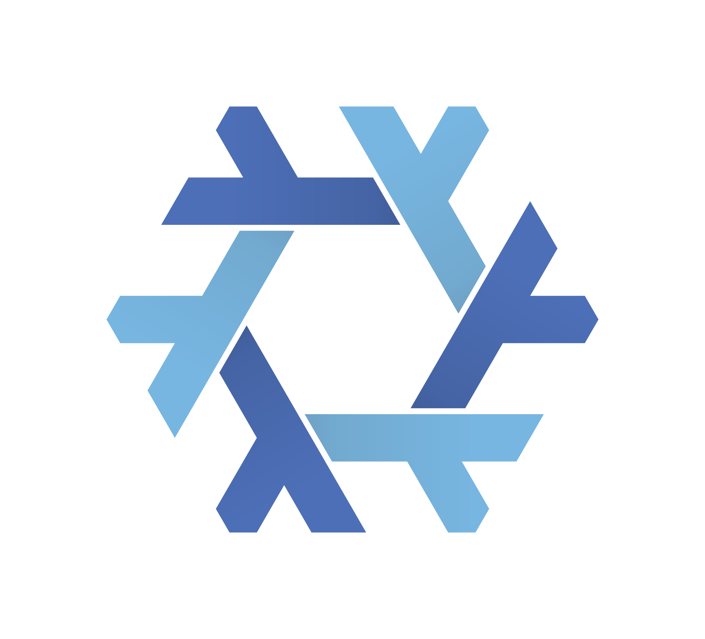

<p align="center">
  <a href="https://nixos.org">
    
  </a>
</p>

<h1 align="center">nixos-lf</h1>

<p align="center">个人 NixOS 系统配置</p>

<p align="center"><a href="README.md">English</a> | 简体中文</p>

这是一套用 Nix flakes 和 Home Manager 管理的个人 NixOS 工作站配置，涵盖 Niri 桌面、日常软件、开发环境和加密存储。网络部分把 `nftables` 防火墙、基于 Mihomo（Clash）的系统级透明代理和带本地 DNSSEC 验证的加密 DNS 整合到了一起。

系统面向 `x86_64-linux`，基于 NixOS 26.05，部分软件取自 Unstable，构建入口为 `nixosConfigurations.lfour`。

## 网络安全与架构

宿主机通过 `nftables` 控制 IPv4/IPv6 的入站、出站和访客转发，并由 systemd 协调器以原子事务切换网络模式。请求开启代理时，系统会先切到 **C**（阻断）模式，等监听端口、路由、DNS 和 TUN 的健康检查全部通过后，再放行进入 **B**（代理）模式。内核为 **B** 维护了一张最长 60 秒的授权租约，只有健康检查持续通过才能续期；一旦到期，普通应用流量（包括已经建立的连接）都会被 `nftables` 拦下。具体细节见[模式与执行](docs/CN/network_CN.md#模式与执行)。

| 模式 | 普通应用流量 | 公网 DNS |
|---|---|---|
| **A** · 直连 | 原生 socket 直接走有线或 Wi-Fi 出站 | Unbound 走 DoT 查询并在本地验证 DNSSEC |
| **B** · 代理 | TCP/UDP 经 TUN 进入 Mihomo；TCP 后备路径通过 `nftables` 重定向给 Gost | Mihomo 本地验证 DNSSEC 并走 DoH 上游；默认返回 fake-IP，启用 WireGuard 出口时返回验证后的真实地址 |
| **C** · 阻断 | 阻断普通外部流量，只放行必要的链路维护和代理恢复路径 | 保留本地解析和符合条件的缓存应答 |

- **透明代理与出口策略**：TUN 和 Gost 两条路径都会穿过私有 `veth` 进入 Mihomo 所在的独立网络命名空间，宿主防火墙会在边界复核核心流量。在 **B** 模式下，`rules` 子模式按订阅规则分流（直连、代理或拒绝），而 `proxy-only` 会把受支持的流量固定到单一已批准的出口上，禁止应用绕开独立出站。如果需要原生 IPv4/IPv6 `ping`，还可以配一个 WireGuard 对端来承载固定的 SOCKS5 中继和 ICMP。详见[流量路径](docs/CN/network_CN.md#流量路径)和[路由策略](docs/CN/proxy_CN.md#路由策略)。
- **订阅信任与 GUI 权限**：订阅登记和快照授权由 root 服务把关，低权限进程只负责下载和渲染候选配置；路由策略、DNS 和代理保留端口也归系统服务管。Clash Verge 只能通过受限的 Unix socket 看状态、选允许的节点，改不了核心模式或系统代理。详见[代理核心与权限](docs/CN/proxy_CN.md)。
- **DNS 分流与过滤**：系统查询沿 `systemd-resolved → dnsmasq → Unbound / Mihomo` 流转。`nftables` 会把普通出站的 53 端口查询重定向回来，`dnsmasq` 和 Mihomo 共用同一份域名黑名单。在兼容的模式下，已批准的 Wi-Fi 分流 DNS 和 Tailscale MagicDNS 各自走受限路径。详见 [DNS 策略](docs/CN/dns_CN.md)。
- **上行链路与本地服务**：有线由 `dhcpcd` 管理，Wi-Fi 由 NetworkManager 管理，支持按 Wi-Fi profile 独立配置 MAC、DHCP 和 IPv6 身份，也可以给 IPv4 网关做 ARP 绑定。防火墙按当前模式放行链路维护、带 NTS 认证的 Chrony 校时，以及经 Tailscale 访问的 Sunshine 等已声明服务。详见[链路身份](docs/CN/identity_CN.md)和[直连例外](docs/CN/egress_CN.md)。
- **访客与浏览器隔离**：经宿主机路由的访客网络按网桥和源网段授权，**B** 模式下可按需开启 IPv4 TPROXY；直接创建宿主 socket 的受限容器后端则靠独立 UID 隔离。日用 Firefox 跟随宿主网络策略，身份浏览器跑在独立命名空间里、走仅在 **B** 开放的专用中继，而门户登录则在 **A** 下拉起临时浏览器。详见[访客网络](docs/CN/network_CN.md#访客与容器)和 [Firefox 网络策略](docs/CN/browser_CN.md#网络策略与身份)。

[网络模块源码](system/config/network/)和 [NixOS 虚拟机测试](tests/checks.nix)覆盖了模式切换、DNS 路由、访客隔离和 WireGuard 出口等场景。要了解配置与排障细节，可以从[网络文档索引](docs/CN/README_CN.md)开始看。

## 桌面与系统

- **Wayland 桌面**：默认会话是 Niri，搭配 Noctalia 负责状态栏、启动器、通知和随壁纸联动的主题；GDM 里也留了 GNOME 可选。中文输入法使用 Fcitx5 + Rime。
- **存储与持久化**：Disko 声明了基于 LUKS2 加密的 Btrfs 布局，每次开机重建根子卷，Impermanence 负责把指定的系统和应用数据留在 `/persist`。
- **开发环境**：配好了 Brush、带 LSP 的 Neovim、VS Code 和 Zed，外加 rootless Docker、虚拟化工具，以及给传统 Linux 二进制准备的 FHS 环境。
- **Firefox**：使用原生 Nix 包，内置锁定的隐私策略、外层文件系统沙箱、独立身份 profile 和临时门户浏览器，每次启动都会先核对网络状态。
- **Hermes Agent**：agent、gateway、dashboard、MCP 集成和技能全部声明在 Nix 里，数据放在 `/var/lib/hermes`，容器工作负载使用独立账户和 Docker 后端。
- **硬件与远程访问**：按作者本机配置了 AMD/NVIDIA 显卡、音频、蓝牙、USBGuard 和跑在 Tailscale 上的 Sunshine 串流。初次启用 USBGuard 和设备授权可以参考 [USBGuard 使用说明](scripts/README_CN.md#usbguard-策略)。

各个功能对应的模块位置都在[源码目录](docs/CN/layout_CN.md)里列好了。

## 使用这套配置

这是一套针对特定机器写的配置。如果要用到自己的设备上，得先改好用户账户、硬件标识、磁盘布局、持久化路径和加密密钥；尤其如果目标机器上已经有系统，务必先搞清楚 Disko 和开机重置根目录的逻辑。全新安装可以参考独立的 [Disko 安装示例](https://github.com/lfourneen/nixos-disko-lf)。

克隆仓库：

```sh
git clone https://github.com/lfourneen/nixos-lf.git
cd nixos-lf
```

建议从下面这些文件开始改：

| 文件 | 需要调整的内容 |
|---|---|
| [flake.nix](flake.nix) | 系统输出名、用户集成和依赖版本 |
| [system/config/user.nix](system/config/user.nix) | 账户与用户组 |
| [system/config/machine.nix](system/config/machine.nix) | 网络接口、地址、端口和服务身份 |
| [system/hardware/](system/hardware) | 磁盘布局、启动、CPU 和 GPU 配置 |
| [system/hardware/partition.nix](system/hardware/partition.nix) | 需要持久保存的目录与文件 |
| [system/programs/sops.nix](system/programs/sops.nix) | 密钥声明和 Age 私钥位置 |
| [home/](home) | 桌面、shell、编辑器和应用偏好 |

这台机器默认开启严格加密 DNS，而且要求代理来源必须先登记，所以想用代理模式前得先完成[来源登记](docs/CN/operations_CN.md#来源登记)。一旦请求了代理，只要核心不可用，系统就会持续阻断普通应用流量，直到代理恢复或者你主动切回直连。

改好配置后，先干跑一次构建看看有没有报错：

```sh
nix build --no-link .#nixosConfigurations.lfour.config.system.build.toplevel
```

确认没问题再切换生效：

```sh
sudo nixos-rebuild switch --flake .#lfour
```

如果你改了 flake 输出名，把命令里的 `lfour` 换成自己的名字，之后重建也都指向自己维护的那份仓库就行。

NixOS 发行分支和共用的 `stateVersion` 在 [flake.nix](flake.nix) 里。升级版本时记得同步更新 Nixpkgs 和 Home Manager 的 input 分支；`stateVersion` 保持不动就行，除非你确认过不兼容变更并完成了应用数据迁移。

## 日常网络操作

| 命令 | 用途 |
|---|---|
| `clash-on` | 请求代理并启动受管核心 |
| `clash-off` | 切换到 **A**，并确认直连防火墙与路由策略生效 |
| `clash-rules` | 选择订阅规则路由并请求健康 **B** |
| `clash-proxy-only` | 选择严格代理路由并请求健康 **B** |
| `clash-egress [ID]` | 列出已接受来源的出口候选，或经受保护事务选择其中一个 |
| `sudo proxy-control recover [--cached]` | 在 **C** 持续阻断应用流量的状态下，下载新候选或应用已有缓存 |
| `proxy-status` | 查看当前模式、DNS 和就绪状态 |
| `clash-diff` | 只读查看来源变化，不影响当前网络模式 |
| `firefox-identity` | 通过严格代理入口打开独立身份 profile |
| `firefox-portal http://192.168.1.1/` | 在直连模式下打开临时门户会话 |

总之，**A** 是直连，**B** 是健康的代理可用状态，**C** 则是代理挂掉或未就绪时的断网保护状态。关掉 GUI 窗口不会停掉受管核心；用 `clash-off` 切回 **A** 之后，直连 DNS 是否就绪可以单独用 `proxy-status` 看。

Clash Verge 保留了上游打包，主要用来选节点和看监控，它在界面里点的 System Proxy、TUN 和核心模式切换都会被系统静默丢弃。想在 `rules` 和 `proxy-only` 之间切换请用上面的系统命令，两种模式下 Mihomo 内部都保持 `mode: rule`。跑 `clash-on` 时，受控订阅会优先恢复上次已接受的快照；常规启动更新会等到 **B** 健康后才触发，万一恢复出来的快照本身不健康，系统也会在 **C** 下尝试一次有时限的恢复。

在 Clash Verge 里点刷新按钮会把已登记订阅的更新提交给系统。开启自动更新后，定时刷新默认每 30 分钟跑一次（按订阅配置的间隔来），哪怕关掉 GUI 也会继续在后台执行。如果新配置没有改变转发行为，且当前快照依然有效、健康，现有连接不会中断；一旦转发行为有变，系统会先退回 **C** 再重启核心。下载和应用结果都可以用 `proxy-status` 查看（参见[刷新状态](docs/CN/operations_CN.md#刷新状态)），更多来源管理、排障和离线恢复办法见[操作与诊断](docs/CN/operations_CN.md)。

## Hermes 与密钥

Hermes 的配置和技能都在 [system/programs/hermes/](system/programs/hermes)。在交互式 Brush 里直接运行 `hermes` 就能进 CLI，也可以在任何 Shell 里用 `sudo -u hermes -i hermes`。容器入口和数据管理见 [Hermes 容器](docs/CN/operations_CN.md#hermes-容器)。

密钥交给 `sops-nix` 管理。系统服务默认用 `/persist/secrets/age/system.key` 这把只有 root 能读的 Age 私钥解密，所以第一次重建系统前得先把密钥放好。怎么接管现有的 `age.txt` / `keys.txt`、从头生成身份、把公钥写入 `.sops.yaml` 以及重新加密文件，都可以看[脚本说明](scripts/README_CN.md#system-age-keypy)。私钥千万别提交到 Git，记得做好离线备份。如果想回退到用户目录下的 `~/.config/sops/age/keys.txt`，设一下 `my.secrets.systemAgeKey.enable = false` 就行。

以 root 编辑系统密钥时，需要显式指定系统私钥路径：

```sh
sudo SOPS_AGE_KEY_FILE=/persist/secrets/age/system.key \
  sops edit system/secrets/secrets.yaml  # API 和消息服务凭据
sudo SOPS_AGE_KEY_FILE=/persist/secrets/age/system.key \
  sops edit system/secrets/soul.yaml     # Hermes 人格设置
sudo SOPS_AGE_KEY_FILE=/persist/secrets/age/system.key \
  sops edit system/secrets/proxy.yaml    # 代理来源清单
```

用 root 保存会改掉文件属主，提交前记得 `sudo chown "$USER": ...` 改回来，再重建系统让修改生效。密钥名称和对应的服务属主都声明在 [sops.nix](system/programs/sops.nix)。

## 仓库导航

| 目录 | 内容 |
|---|---|
| [system/](system) | 系统服务、硬件、网络策略和软件包 |
| [home/](home) | Home Manager 模块和用户应用 |
| [overlays/](overlays) | 软件包覆盖 |
| [local-data/](local-data) | 纳入版本管理的构建输入，如 DNS 黑名单快照 |
| [maintenance/](maintenance) | 全仓库更新台账和核查命令 |
| [scripts/](scripts) | 配置复制工具和黑名单刷新脚本 |
| [tests/](tests) | 软件包、策略和隔离 VM 检查 |
| [assets/](assets) | README 图标和署名 |
| [docs/](docs/CN/README_CN.md) | 架构、配置、日常操作和维护手册 |

可以用 `python3 scripts/check-maintenance.py` 校验更新台账。动网络栈或升级相关依赖前，建议先按[维护手册](docs/CN/maintenance_CN.md)挑好要跑的检查，并核对本地补丁。

## 许可证

本项目基于 MIT License 授权，详见 [LICENSE](LICENSE) 文件。
